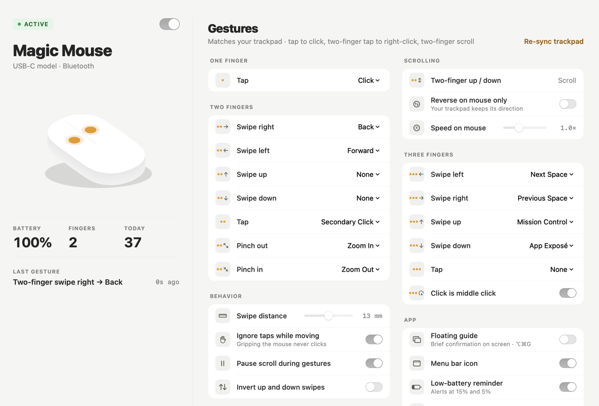
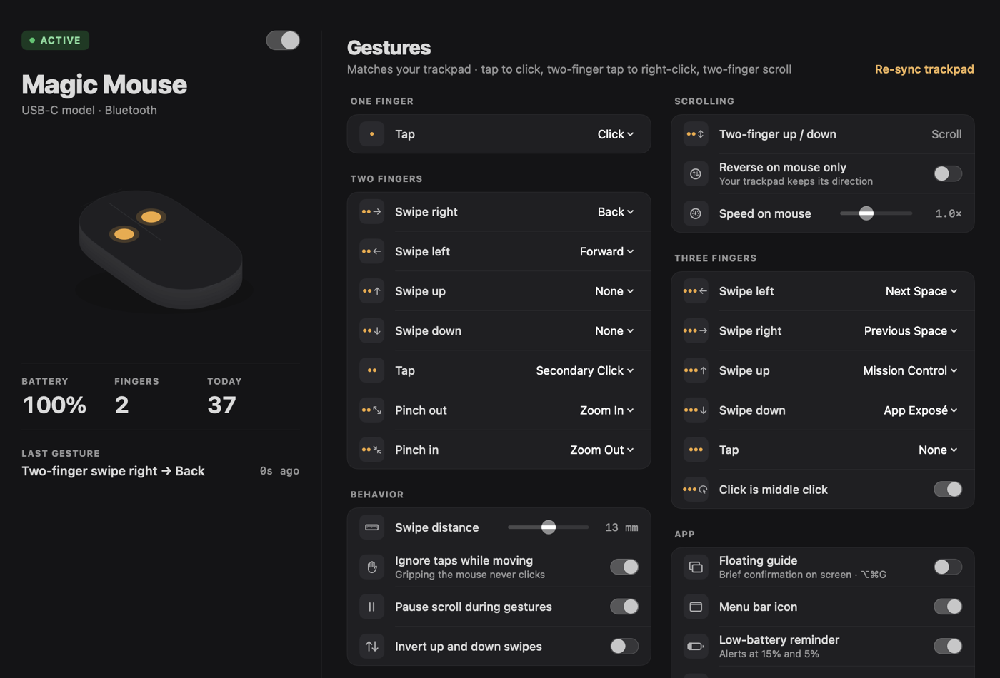

<p align="center">
  
</p>

<h1 align="center">MagicMousePad</h1>

<p align="center"><b>Your Magic Mouse, now a trackpad.</b><br>
Two- and three-finger swipes, taps and pinches for every Magic Mouse — including the new USB‑C model.<br>
Free, open source, and native to macOS.</p>

<p align="center">
  <a href="../../releases/latest">Download</a> ·
  <a href="#install">Install</a> ·
  <a href="#gestures">Gestures</a> ·
  <a href="#build-from-source">Build</a>
</p>

<p align="center">
  
  <br>
  
</p>

---

## Why

The Magic Mouse has always been a small multi-touch surface wearing a mouse's clothes. Its top shell is a capacitive sensor that can see every finger — yet macOS only uses it for scrolling and a couple of gestures. Meanwhile, everything you've learned on a trackpad stops working the moment your hand moves to the mouse.

MagicMousePad closes that gap with five ideas:

1. **The trackpad you already know.** It copies your own trackpad settings: tap to click, two-finger right-click and scroll, pinch to zoom, three-finger Spaces and Mission Control. Zero new vocabulary.
2. **Click where you are.** The whole shell is one button, but the surface knows how many fingers are on it. Click with three fingers and you get a real **middle click** — something the Magic Mouse never had.
3. **Feedback without haptics.** There's no Taptic Engine in a mouse, so every gesture is confirmed with a brief floating guide. You always know it worked — and you can hide it once you trust it.
4. **One gesture, one result.** When macOS's own mouse gestures overlap with yours, the app tells you exactly which setting to turn off. Scrolling pauses while a multi-finger gesture is on the surface so pages don't jump.
5. **Fewer, better gestures.** A curved 5 × 9 cm surface isn't a trackpad. Only gestures that are comfortable on it are offered, and swipe distance is measured in millimetres for your exact mouse, so every generation feels the same.

## Gestures

**Trackpad mode is the default.** On first launch MagicMousePad reads *your* trackpad settings (System Settings › Trackpad) and copies them onto the mouse surface. The pointer still moves with the mouse; only the top surface becomes a trackpad. Change your trackpad later? Click **Re-sync**.

With a typical trackpad setup that means:

| Fingers | Gesture | Action |
|---|---|---|
| 1 | Tap | Click (when *Tap to click* is on; tap twice to double-click) |
| 2 | Tap | Secondary click |
| 2 | Move up / down | Scroll, exactly as before |
| 2 | Swipe right / left | Back / Forward |
| 2 | Pinch out / in | Zoom in / out |
| 3 | Swipe left / right | Next / Previous Space |
| 3 | Swipe up / down | Mission Control / App Exposé |
| 3 | **Physical click** | **Middle click** — a bonus the Magic Mouse never had |

Four-finger trackpad gestures fold into three-finger ones, since three is the most a Magic Mouse comfortably holds.

Every gesture can be reassigned to: Click, Secondary Click, Middle Click, Look Up, Mission Control, App Exposé, Show Desktop, Show Apps, Next/Previous Space, Back, Forward, Next/Previous Tab, Close Tab, Zoom In/Out, Actual Size — or nothing.

### Fixes for the most common Magic Mouse complaints

What people ask for most in Magic Mouse threads, issue trackers and reviews, and what the app does about it:

| Complaint | What MagicMousePad does |
|---|---|
| No middle click | Three-finger physical click (drag works too) |
| Resting fingers trigger things by accident | Taps only count from an empty surface, and **taps are ignored while you're moving or gripping the mouse** |
| Scroll direction is shared with the trackpad | **Reverse direction and speed for the Magic Mouse only** — the trackpad keeps its own |
| The charging port is underneath | **Low-battery reminder** at 15% and 5%, so you charge it while you're away |
| Menu bar is crowded | **Hide the menu bar icon**; open the app again to get the window back |
| Gestures fire twice with macOS's own | Detects overlapping built-in mouse gestures and links to the setting |

The **floating guide** (a small capsule confirming each gesture) can be hidden with the switch in the window, from the menu bar, or with **⌥⌘G**.

## Install

1. Download the latest **MagicMousePad-x.y.z.dmg** from [Releases](../../releases/latest).
2. Drag **MagicMousePad** into **Applications** and open it.
3. The first launch shows a window asking for **Accessibility** access — click **Allow…** and switch MagicMousePad on in System Settings › Privacy & Security › Accessibility. This is what lets the app switch Spaces, go back and click on your behalf.

> **"MagicMousePad can't be opened"?** Release builds are signed ad hoc, not notarized by Apple. Open **System Settings › Privacy & Security**, scroll down and click **Open Anyway** — or run
> `xattr -dr com.apple.quarantine /Applications/MagicMousePad.app`

The app lives in your menu bar (the mouse icon). Click it to pause gestures, see the battery level, or open the window. Turn on **Open at login** in the window to keep it running.

### Tips

- **Turn off overlapping macOS gestures.** In System Settings › Mouse › More Gestures, turn off *Swipe between full-screen applications* and *Mission Control* (two-finger double-tap). The app shows a banner when it detects either.
- **Switching Spaces** uses the standard *Move left/right a space* shortcuts (⌃← / ⌃→). They're on by default; if you've disabled them, re-enable them in System Settings › Keyboard › Keyboard Shortcuts › Mission Control.
- **Rebuilt the app yourself?** Each new ad-hoc build has a new signature, so macOS may ask for Accessibility again. Remove the old entry and add the new one.

## Compatibility

- macOS 13 Ventura or later (Apple silicon and Intel)
- Magic Mouse (original), Magic Mouse 2, and Magic Mouse with USB‑C
- Bluetooth or wired

## How it works

```
MultitouchSupport.framework ──► CMultitouch (C bridge, loaded with dlopen)
            │ raw finger frames
            ▼
   TouchEngine ──► GestureRecognizer (pure Swift, unit-tested) ──► ActionPerformer
            │                                                     (Dock / key events / clicks)
            ▼
   EventFilter (CGEvent tap): pauses scroll during gestures, 3-finger click → middle click
```

- **`Sources/CMultitouch`** — a tiny C bridge to Apple's private MultitouchSupport framework. It is loaded at runtime, so if Apple ever changes it the app degrades gracefully instead of crashing.
- **`Sources/MagicMousePadCore`** — the gesture model and recognizer. No AppKit, fully covered by `swift test`.
- **`Sources/MagicMousePad`** — the SwiftUI menu-bar app: device hot-plug, actions, event filter, HUD and the window.

Nothing leaves your Mac. There is no network code, analytics or telemetry.

## Build from source

Requires Xcode 15 or later (or the Command Line Tools with Swift 5.10+).

```bash
git clone https://github.com/rzrizaldy/magicmousepad.git
cd magicmousepad
make test      # run the recognizer tests
make install   # build a universal app, copy it to /Applications and launch it
```

Other targets: `make app` (build `build/MagicMousePad.app`), `make dmg` (build a disk image), `make run` (debug build from the terminal), `make icon` (regenerate the app icon).

To sign with your own Developer ID: `SIGN_IDENTITY="Developer ID Application: …" make app`.

Releases are built by GitHub Actions: push a tag like `v1.0.0` and the workflow attaches a DMG to the release.

## Contributing

Issues and pull requests are welcome. Good places to start:

- Per-app gesture mappings
- Additional actions (Notification Center, Look Up, custom shortcuts)
- A Homebrew cask

Please keep `swift test` green and the UI consistent with the existing design language (pearl background, glass cards, champagne gold).

## License

[MIT](LICENSE). Not affiliated with Apple. Magic Mouse is a trademark of Apple Inc.
